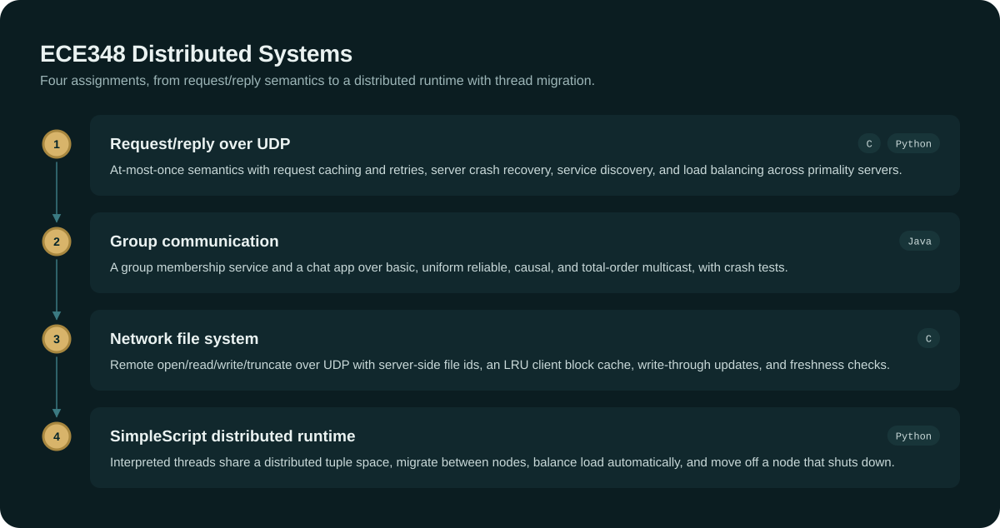
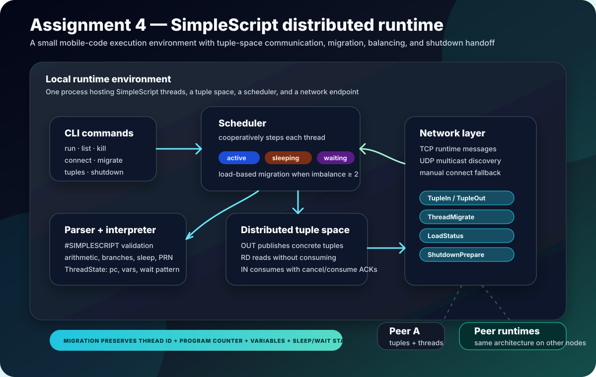

# ECE348 — Distributed Systems


Coursework repository for **ECE348 — Distributed Systems** at the **University of Thessaly**. The assignments build distributed services and runtimes from UDP request/reply protocols to reliable group communication, a cached network file service, and a SimpleScript execution environment with transparent tuple-space operations and thread migration.

The repository keeps the implementations, tests, benchmark plots, handouts, and final presentation decks for the four assignments. Assignment 4 is the main showcase: a distributed runtime that can discover peers, execute mobile SimpleScript threads, migrate blocked or sleeping computation, balance load, and drain work during shutdown.

## Quick overview

| Area | What is included |
| --- | --- |
| Request/reply protocols | UDP client/server API with at-most-once semantics, crash recovery, service discovery, primality workers, and multi-server load balancing. |
| Group communication | Java group management service, chat application, reliable multicast layers, causal/total ordering, membership updates, and process-failure handling. |
| Network file system | C client/server file API over UDP with remote open/read/write/truncate, file-id recovery, LRU block cache, write-through updates, and freshness validation. |
| Distributed runtime | SimpleScript parser/interpreter, cooperative scheduler, tuple space, distributed `OUT`/`RD`/`IN`, thread migration, load balancing, and graceful shutdown. |

<p align="center">
  
</p>

## Standout work: SimpleScript distributed runtime

<p align="center">
  
</p>

The strongest project is **Assignment 4**, a distributed runtime for the intentionally small SimpleScript language. It behaves like a compact mobile-code execution environment: programs run as managed threads, block on tuple-space operations, migrate between runtime nodes, and continue execution after load-balancing or shutdown handoff.

- **Language runtime:** parses `#SIMPLESCRIPT` programs and executes arithmetic, branching, sleeping, printing, and tuple operations one instruction at a time.
- **Thread scheduler:** tracks active, sleeping, and waiting `ThreadState` objects so blocked tuple operations and sleeping computations can be resumed later.
- **Distributed tuple space:** supports local and remote `OUT`, non-destructive `RD`, and destructive `IN` with request forwarding, completion, cancel, and consume messages.
- **Node discovery:** combines UDP multicast discovery with a manual `connect <ip> <port>` fallback for cross-machine demos.
- **Live migration:** transfers program code and execution state to another runtime while preserving the same globally unique thread id.
- **Automatic load balancing:** exchanges load status and migrates threads only when the imbalance is large enough to avoid useless oscillation.
- **Graceful shutdown:** coordinates shutdown with peer acknowledgements, marks the node as draining, and migrates local threads and tuples to surviving runtimes.
- **Demo/test coverage:** includes presentation-ready demo scripts plus parser, interpreter, scheduler, tuple-space, migration, and multi-node end-to-end tests.

## Course contents

| Path | Assignment | Implementation summary | Documentation |
| --- | --- | --- | --- |
| [`project1/`](project1/) | Request-reply with at-most-once semantics | C server API and Python client API over UDP, with request caching, ACK/retry behavior, discovery, crash recovery, primality workers, and multi-server load balancing. | [Handout](docs/handouts/assignment-1-request-reply.pdf), [presentation](docs/presentations/assignment-1-request-reply.pptx), [project README](project1/README.md) |
| [`project2/simple-chat-app/`](project2/simple-chat-app/) | Reliable causal-total group communication | Java/Gradle chat application with a TCP group-management service and UDP group messaging layers for basic multicast, uniform reliable multicast, total order, causal order, membership changes, and crash tests. | [Handout](docs/handouts/assignment-2-causal-total-group-communication.pdf), [presentation](docs/presentations/assignment-2-causal-total-group-communication.pptx) |
| [`project3/`](project3/) | Network file system | C client/server file service exposing `mynfs_*` operations over UDP, using server-side file identifiers, client-side LRU block caching, freshness validation, write-through updates, and benchmark plots. | [Handout](docs/handouts/assignment-3-network-file-system.pdf), [presentation](docs/presentations/assignment-3-network-file-system.pptx) |
| [`project4/`](project4/) | Distributed execution environment | Python SimpleScript runtime with parser/interpreter, scheduler queues, distributed tuple-space protocol, TCP node messaging, UDP discovery, live thread migration, load balancing, graceful shutdown, demos, and tests. | [Handout](docs/handouts/assignment-4-distributed-runtime.pdf), [presentation](docs/presentations/assignment-4-distributed-runtime.pptx), [demo guide](project4/demo/README.md), [cross-machine demo](project4/docs/CROSS_MACHINE_DEMO.md) |

## Selected results

Benchmark plots remain next to the assignments that produced them, so the README can point to the measurements without turning the landing page into a plot gallery:

- [`project1/client/tests/throughput_scaling_plot.png`](project1/client/tests/throughput_scaling_plot.png) — request/reply throughput scaling with server workers and load.
- [`project2/simple-chat-app/benchmarks/`](project2/simple-chat-app/benchmarks/) — group communication throughput measurements.
- [`project3/client/results/`](project3/client/results/) — NFS traffic, block-size, cache-throughput, and cache-thrashing experiments.

## Requirements

| Assignment | Main requirements |
| --- | --- |
| Project 1 | Linux, C compiler, `make`, Python 3, UDP networking on localhost or lab machines. |
| Project 2 | Java, Gradle wrapper included in the project, TCP/UDP localhost ports for GMS and clients. |
| Project 3 | Linux, C compiler, `make`, POSIX file APIs, UDP networking, writable server export directory. |
| Project 4 | Python 3 and `pytest` for the runtime tests; multiple terminals or machines for the distributed demos. |

## Build and run

Project 1 server library and demo tests:

```bash
cd project1/server
make

cd ../client
python3 tests/stress_test.py      # representative long-running black-box test
python3 tests/rapid_fire.py       # representative throughput/load test
```

Project 2 group communication app and tests:

```bash
cd project2/simple-chat-app
./gradlew test
```

Project 3 client/server components:

```bash
cd project3/common && make
cd ../server && make
cd ../client && make
```

Project 4 SimpleScript runtime:

```bash
cd project4
python3 src/main.py --load-balance
```

Run the Assignment 4 tests:

```bash
cd project4
python3 -m pytest
```

A typical two-node runtime demo uses two terminals running `python3 src/main.py --load-balance`, then commands from [`project4/demo/README.md`](project4/demo/README.md) such as `run demo/02_tuple_consumer.ss`, `run demo/03_tuple_producer.ss`, `migrate <thread> <ip> <port>`, and `shutdown`.
